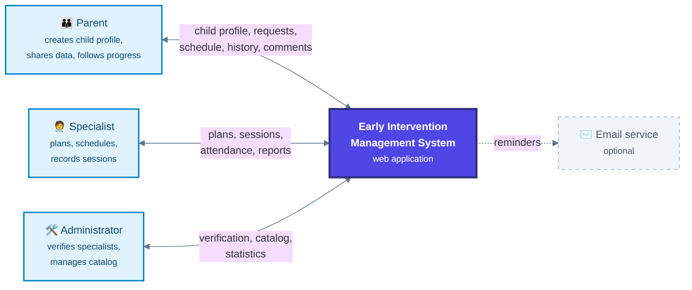
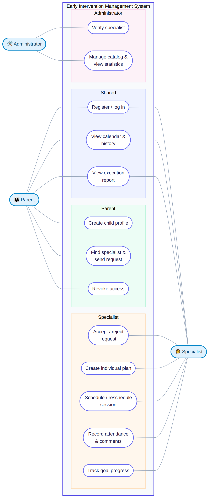
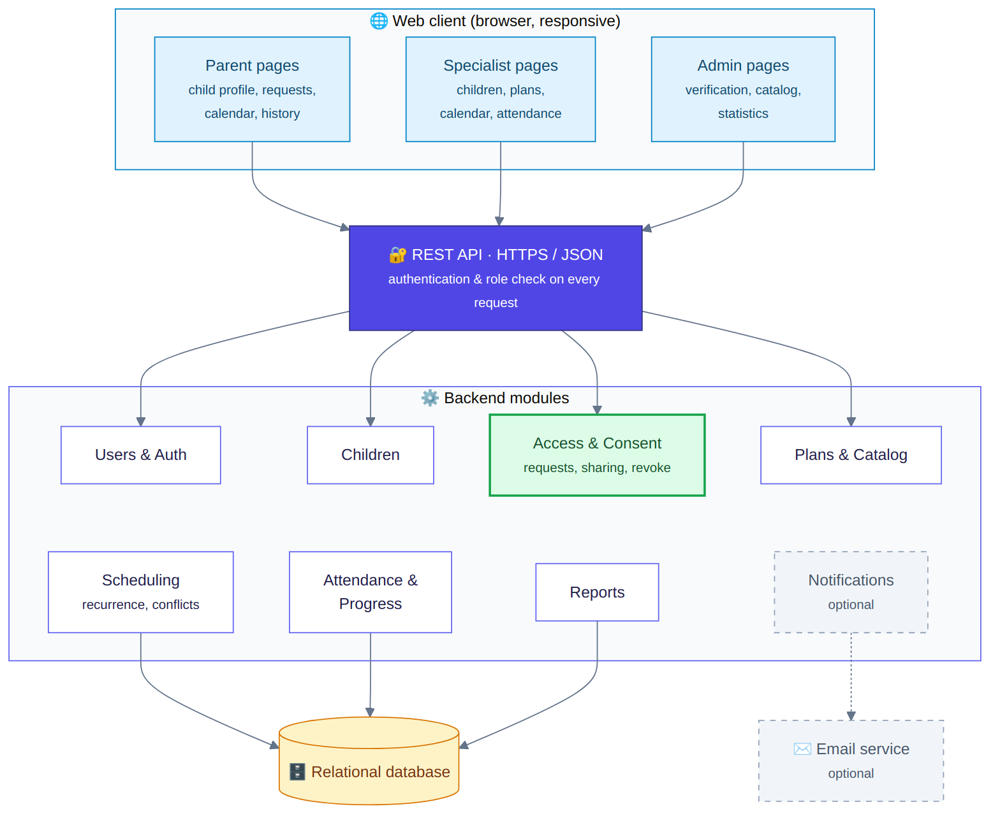
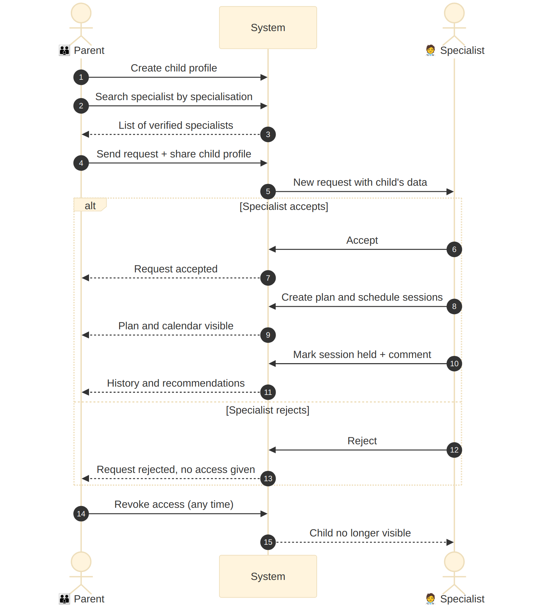

# Architecture and Diagrams

## 1. Architectural style

Client-server architecture with two clients and one backend:

- **Parent mobile app (Flutter, Android / iOS)** — child profile, search for specialists and requests, access management, calendar, history and recommendations.
- **Web application (React)** — interface for specialists (children, plans, calendar, attendance) and administrators (verification, catalog, statistics). Specialists work mostly at a computer, so a web interface fits them better.

Both clients only show data and send requests; they contain no business rules, so all logic is written once on the server.
- **Backend (REST API)** — all business logic: authentication, roles, consent-based access, plans, scheduling, attendance, reports. Every request is checked for the user's role and access rights.
- **Relational database** — users, children, access grants, plans, sessions, comments. A relational model fits strongly connected data and reports with aggregation.

**Central design decision:** the child's profile belongs to the parent. A specialist gets access only through an accepted request (access grant), and the parent can revoke it. This is handled by a separate *Access & Consent* module so that every other module checks access in one place.

## 2. System context diagram

Source: [`context-diagram.mmd`](diagrams/context-diagram.mmd)

## 3. Use case diagram

Source: [`use-case-diagram.mmd`](diagrams/use-case-diagram.mmd)

## 4. Component diagram (draft)

Source: [`component-diagram.mmd`](diagrams/component-diagram.mmd)

| Component | Responsibility |
|---|---|
| Users & Auth | Registration, login, password hashing, roles, specialist verification |
| Children | Child profiles owned by parents |
| Access & Consent | Requests from parent to specialist, accept / reject, revoke, access log; used by all other modules to check rights |
| Plans & Catalog | Individual plans, goals, statuses; catalog of session types |
| Scheduling | Calendar, recurring sessions, overlap check, rescheduling, cancellation |
| Attendance & Progress | Session status, comments and home recommendations, goal progress |
| Reports | Planned vs held sessions, attendance rate, admin statistics |
| Push notifications (optional) | Reminders to parents about upcoming sessions via Firebase Cloud Messaging |

## 5. Key scenario: connecting to a specialist

Source: [`sequence-data-sharing.mmd`](diagrams/sequence-data-sharing.mmd)

## 6. Main data entities (draft)

| Entity | Main fields |
|---|---|
| User | id, name, email, password_hash, role (parent / specialist / admin), verified |
| Child | id, name, birth_date, concerns, notes; user account linked to one or more parents (ParentChild); no own login |
| AccessGrant | child_id, specialist_id, status (pending / accepted / rejected / revoked), dates |
| SessionType | name, duration, specialisation |
| Plan | child_id, specialist_id, period, status |
| Goal | plan_id, description, status |
| Session | plan_id, specialist_id, start, end, status, reason |
| SessionComment | session_id, author_id, text, recommendations, created_at |
| AuditLog | user_id, action, entity, time |

A full ER diagram will be added at the next stage.

## 7. Traceability: requirements → components → use cases

| Requirements | Component | Use case |
|---|---|---|
| FR-01 – FR-04, NFR-01, NFR-02 | Users & Auth | Register / log in, Verify specialist |
| FR-05 – FR-07 | Children | Create child profile |
| FR-08 – FR-13, NFR-03 | Access & Consent | Find specialist & send request, Accept / reject, Revoke access |
| FR-14 – FR-17 | Plans & Catalog | Create individual plan, Manage catalog |
| FR-18 – FR-21 | Scheduling | Schedule / reschedule session, View calendar |
| FR-22 – FR-25 | Attendance & Progress | Record attendance, Track goal progress, View history |
| FR-26 – FR-29 | Reports, Notifications | View execution report, View statistics |
