# UI Prototype: Key User Scenarios

Static mockups of the main screens. The parent screens are designed for the Flutter mobile app, the specialist screens for the React web application. 

Files are in [`prototype/`](prototype/): a PNG image of every screen, two overview images and the editable source `mockups-source.html` .

**Visual direction:** calm teal as the main colour (#3A8F8D for buttons, #7FBFBE for decorative elements), soft pink accent (#E5738A) for things that need attention and for home recommendations, very light teal background (#EEF6F6), periwinkle (#CBD7E8) for neutral information, dark slate text (#21414B)

## Overview

**Parent mobile app (Flutter)**

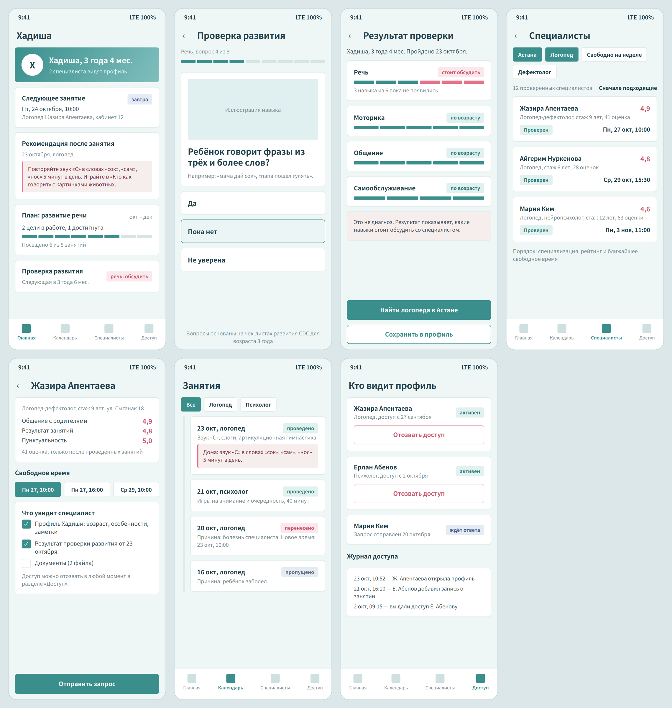

**Specialist web application (React)**

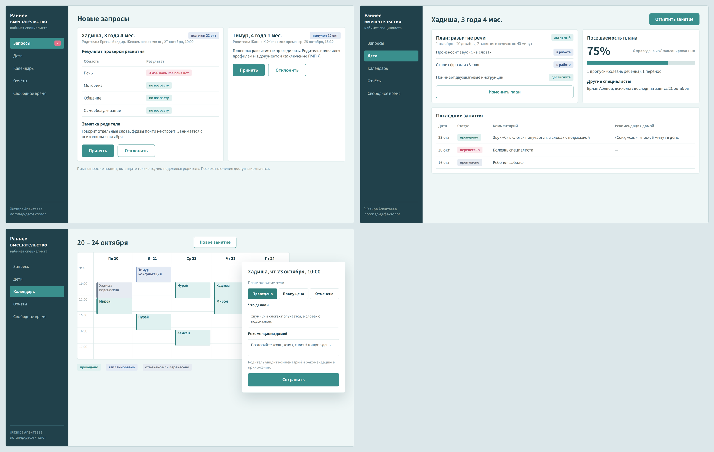

**Interface language:** Russian (main language of the target users; NFR-11).

## Scenario 1. Parent notices a problem and finds a specialist

| Screen | What the user does | Requirements |
|---|---|---|
| 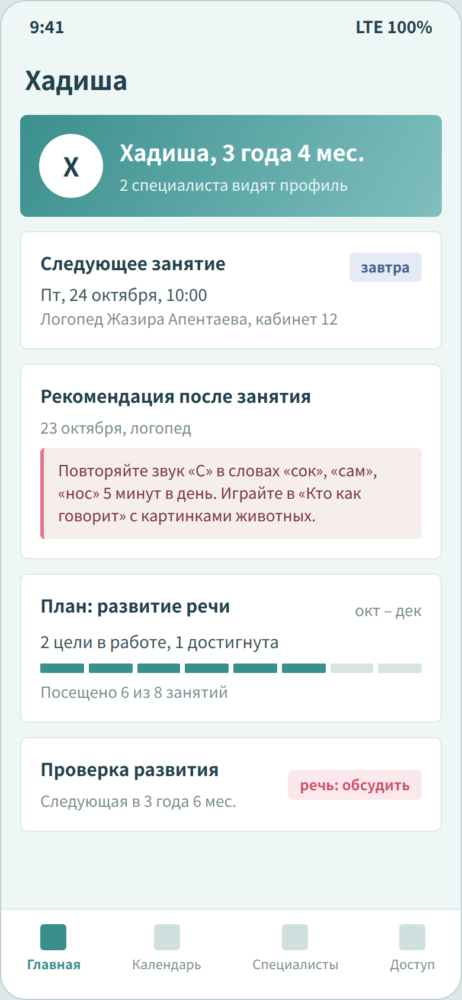 | **Home.** Parent sees the child's profile, next session, the last home recommendation, plan progress and the screening reminder. | FR-05, FR-21, FR-23, FR-24 |
| 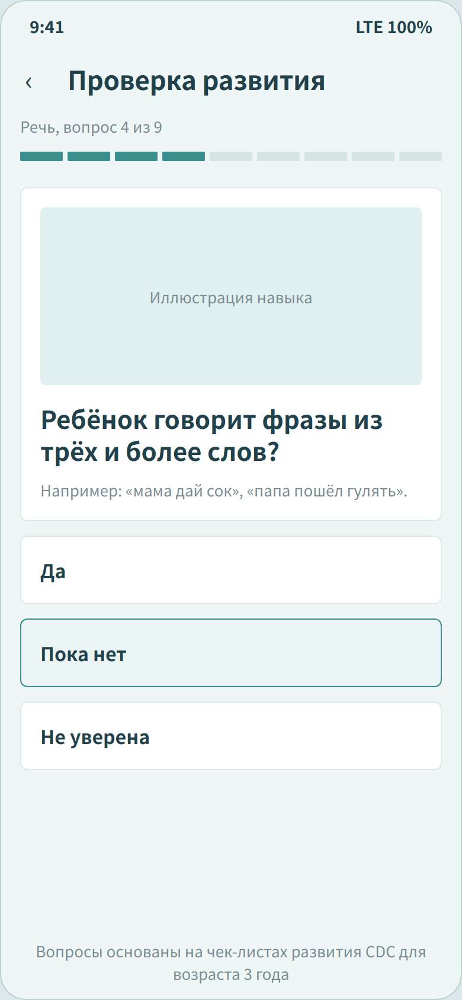 | **Development screening.** Parent answers age-based questions by developmental area, based on CDC milestone checklists. | FR-31 |
| 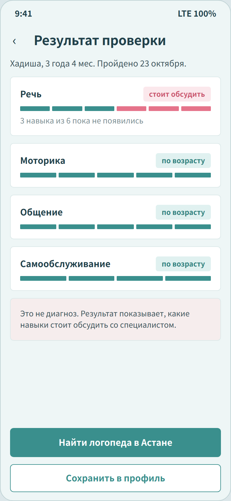 | **Screening result.** Result by area; "worth discussing" for speech; clear statement that this is not a diagnosis; button to find a speech therapist in the parent's city. | FR-32 |
| 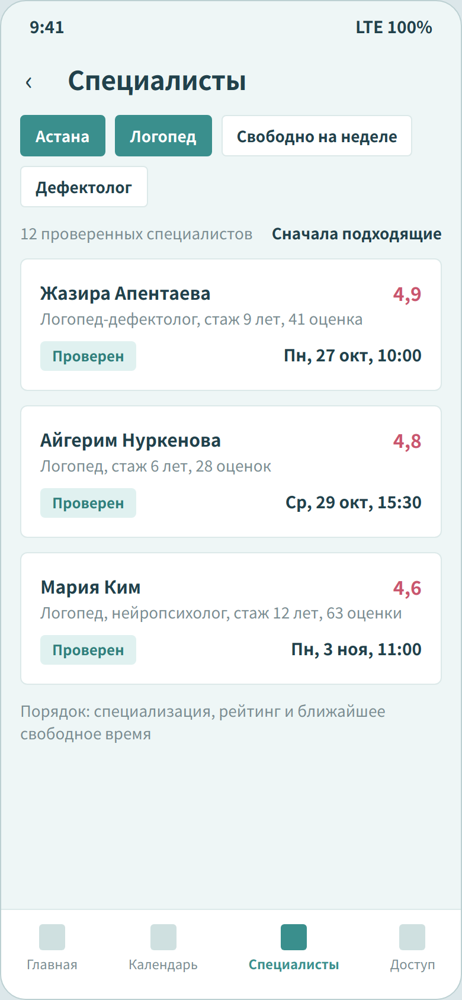 | **Search.** Verified specialists in Astana filtered by specialisation, ordered by match, rating and nearest free time. | FR-08, FR-33, FR-34 |
| 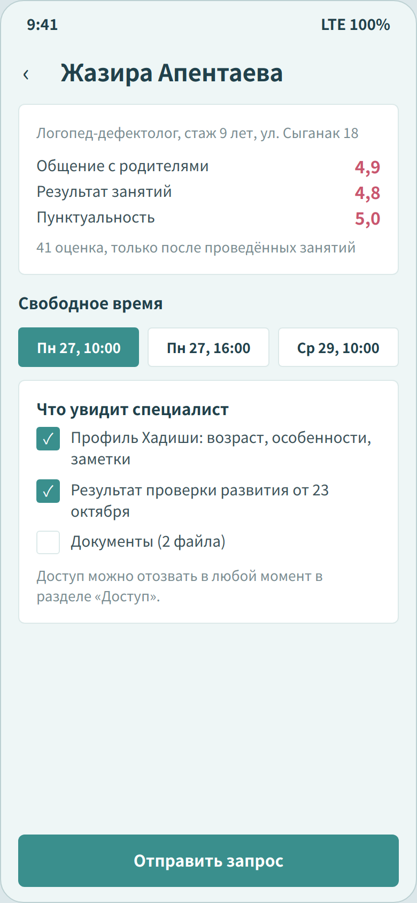 | **Specialist profile and request.** Rating by three criteria, free time slots, and the parent chooses exactly what the specialist will see before sending the request. | FR-09, FR-35, FR-36, NFR-03 |

## Scenario 2. Specialist accepts the child and works with the plan

| Screen | What the user does | Requirements |
|---|---|---|
| 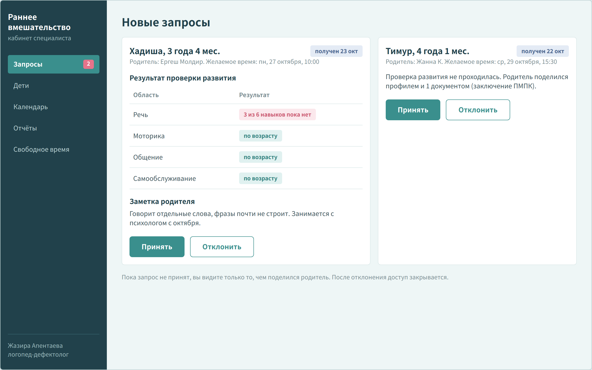 | **Incoming requests.** Specialist sees the child's age, screening result, parent's note and the requested time; accepts or rejects. | FR-10, FR-12 |
| 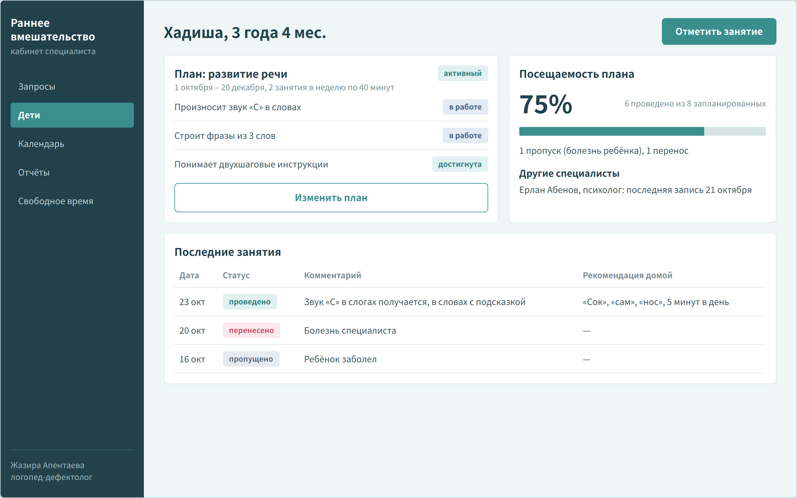 | **Child's page.** Active plan with goals and their status, attendance rate (6 of 8, 75%), other specialists working with the child, latest sessions with comments and home recommendations. | FR-13, FR-14, FR-15, FR-24, FR-25, FR-26 |
| 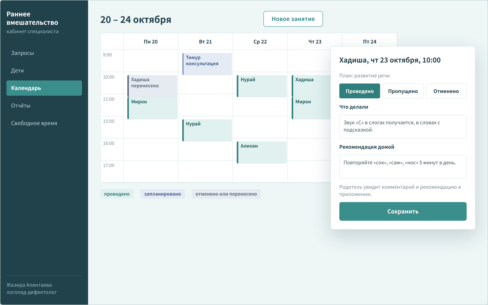 | **Calendar and marking a session.** Week view with statuses; after a session the specialist marks it as held, missed or cancelled and writes what was done and a home recommendation. | FR-18, FR-21, FR-22, FR-23 |

## Scenario 3. Parent follows sessions and controls access

| Screen | What the user does | Requirements |
|---|---|---|
| 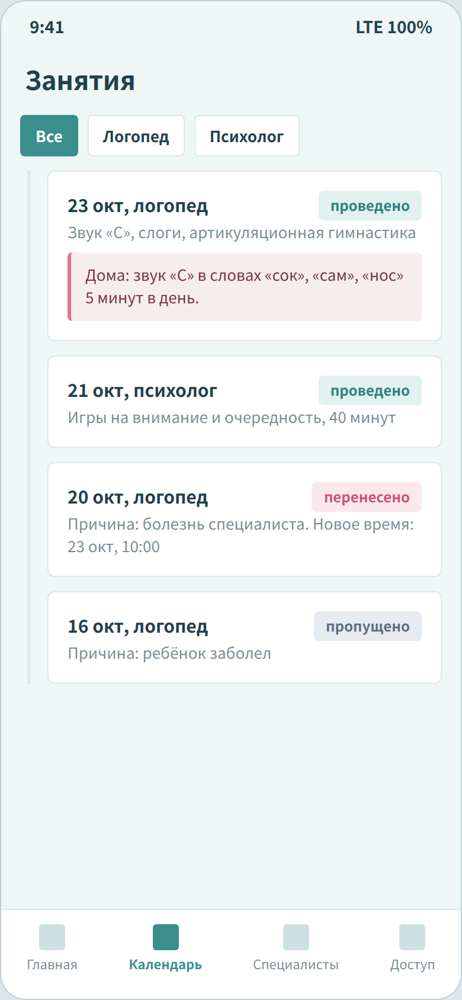 | **Sessions.** History of all sessions with status; rescheduling and missed sessions show the reason; held sessions show the home recommendation. | FR-20, FR-22, FR-23, FR-25 |
| 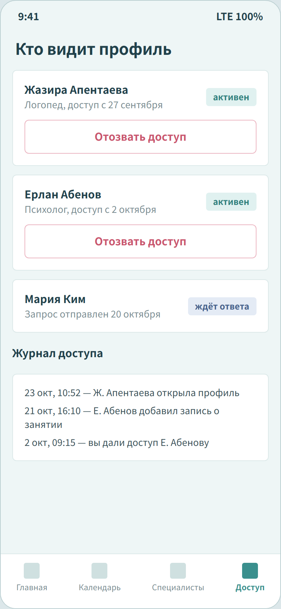 | **Who sees the profile.** List of specialists with access and pending requests; revoke access; access log. | FR-11, NFR-03 |

## Design decisions

- **Developmental areas as tracks.** Progress and screening results are shown as segmented teal bars by area (pink for skills that are not yet present) (speech, motor skills, communication, self-care). The same visual language is used on the home screen and in the specialist's view, so parent and specialist look at the child's development the same way.
- **Explicit consent before sharing.** Before sending a request, the parent sees and chooses what the specialist will see. This answers survey results (H5) and the lack of control in existing systems (see `04-existing-systems.md`).
- **Every change has a reason.** Missed and rescheduled sessions always show a reason, because DOQ.kz users complained about bookings changed without notice.
- **Recommendations stand out.** Home recommendations are highlighted in soft pink, because 31% of surveyed parents get recommendations only when they ask.
- **Phone first for parents.** 92% of surveyed parents prefer a phone, so parent functions are designed for a mobile screen; specialists work with tables and a calendar on a computer.

## Limitations

- These are static mockups, not a working prototype; navigation between screens is shown by scenario order.
- Administrator screens (specialist verification, catalogue, list of users including children with their parents) are not drawn yet; they will be added at the next stage.
- The mockups will be checked with 3–5 users during the usability test (see `08-verification-plan.md`).
